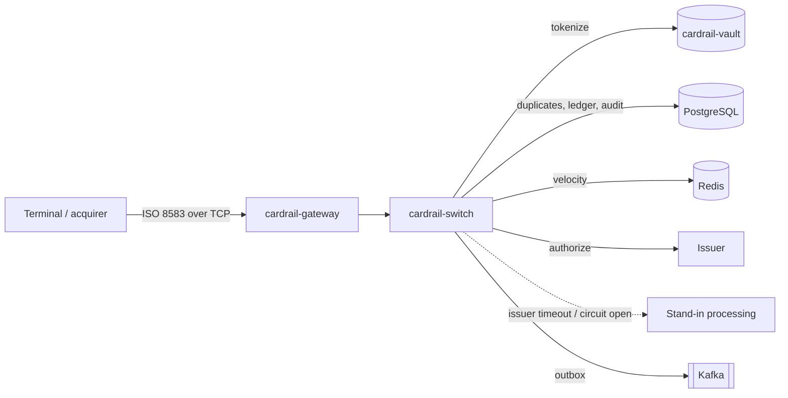

# cardrail

A card payment switch in Java 21 and Spring Boot. It models the path a card payment takes through a
network: an acquirer sends an ISO 8583 authorization request, the switch validates and tokenizes the
card, checks for duplicates, runs risk rules, asks the issuing bank, and falls back to stand-in
processing when the issuer does not answer. Approved amounts are held in a double-entry ledger, every
state change is published through a transactional outbox, and every action is written to a
tamper-evident audit log.



## Modules

| Module | What it is |
|---|---|
| [`cardrail-iso8583`](cardrail-iso8583/) | ISO 8583 codec: MTI, primary and secondary bitmaps, LLVAR/LLLVAR fields, strict decoding with field-level errors, length-prefixed TCP framing, BER-TLV parsing of EMV chip data (field 55). JDK only. |
| [`cardrail-vault`](cardrail-vault/) | Card data protection: Luhn and PAN value types that cannot be printed in full, AES-256-GCM envelope encryption, key rotation that re-wraps keys without touching card data, an HMAC blind index, format-preserving tokens, PAN redaction for logs. JDK only. |
| [`cardrail-switch`](cardrail-switch/) | The Spring Boot service: the authorization pipeline, duplicate detection on the transmission key, risk rules with Redis velocity counters, Resilience4j time limiter and circuit breaker around the issuer, stand-in processing, reversals, captures, hold expiry, a PostgreSQL ledger whose balance rule is enforced by the database, a transactional outbox to Kafka, and a hash-chained append-only audit log. |
| [`cardrail-gateway`](cardrail-gateway/) | ISO 8583 TCP server on virtual threads: pipelined requests per connection, bounded in-flight work with TCP backpressure, per-request deadlines, idle timeouts and graceful drain. |
| [`cardrail-loadgen`](cardrail-loadgen/) | Acquirer simulator and load generator. Open-loop scheduling measured from the intended send time, so latency under load is not hidden by coordinated omission. |
| [`cardrail-apisec`](cardrail-apisec/) | Server-side OAuth 1.0a RSA-SHA256 request verification with body hash and nonce replay protection, and JWE field-level encryption (RSA-OAEP-256 + A256GCM). Tested for interoperability against Mastercard's open-source `oauth1-signer` and `client-encryption` libraries. |

Each module has its own README with design notes, and the switch has architecture decision records in
[`cardrail-switch/docs/adr/`](cardrail-switch/docs/adr/). The contract between modules is
[`docs/SPEC.md`](docs/SPEC.md); service contracts are in [`docs/CONTRACTS.md`](docs/CONTRACTS.md);
the payments background is in [`docs/CONTEXT.md`](docs/CONTEXT.md).

## A few things worth looking at

- **No overdraft under concurrency.** 200 simultaneous authorizations of 100 against a balance of
  10,000 approve exactly 100 and decline 100 with response code 51
  (`cardrail-switch/.../integration/ConcurrencyIntegrationTest.java`).
- **The database refuses an unbalanced journal.** A deferred constraint trigger checks at commit that
  every journal's entries sum to zero, so the invariant does not depend on application code.
- **Stand-in processing.** When the issuer exceeds its time limit or the circuit breaker is open, the
  switch approves only below a per-BIN stand-in limit and records a `stip.advice` event for the issuer.
- **Duplicates are resolved by a unique key, not check-then-insert.** An identical retransmission gets
  the original answer back; a different payload under the same key gets `94`.
- **Card numbers never reach a log line.** A Logback converter masks Luhn-valid digit runs, and a test
  logs a PAN and asserts the output is masked.
- **Business scenarios in Cucumber.** `cardrail-switch/src/test/resources/features/` holds
  authorization, stand-in, reversal and duplicate scenarios written for a product owner to read.

## Running it

Requirements: Java 21, Maven, PostgreSQL and Redis on localhost.

```bash
createdb cardrail && createdb cardrail_test
mvn verify                                   # all modules, all tests
mvn -pl cardrail-switch spring-boot:run -Dspring-boot.run.profiles=dev
```

CI runs the full build on every push with PostgreSQL and Redis service containers
([`.github/workflows/ci.yml`](.github/workflows/ci.yml)).

## What this is not

A learning-grade model of a network switch, built to understand the problem properly. It is not
certified, not PCI DSS compliant, and does not implement any real network's private ISO 8583 dialect
or message specifications. The interchange and stand-in figures in the reference data are illustrative.
Performance numbers appear here only when they have been measured, together with the command that
reproduces them.
