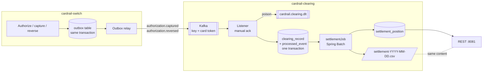

# cardrail-clearing

The clearing and settlement service of cardrail. It consumes the switch's capture and reversal
events from Kafka, turns each capture into a clearing record priced with interchange, and at end of
day runs a Spring Batch job that nets the records into settlement positions per acquirer and per
issuer, reconciles them, and writes a CSV settlement report. Spring Boot 3.5, Java 21, its own
database: PostgreSQL locally, Oracle in CI.

This is a learning-grade model of card clearing. The interchange table is illustrative, not any
network's published rates; real interchange is set per network, region, card product and merchant
program. Scheme fees, currency conversion, chargebacks and settlement files in any real network's
format are out of scope.

## Why it is a separate service

Authorization is online and latency-bound; clearing is a daily batch. Running them as one process
would let a slow settlement run or a clearing bug hurt authorizations. So clearing is its own
deployable with its own database, and the only coupling to the switch is the event contract in
[`docs/CONTRACTS.md`](../docs/CONTRACTS.md) (ADR [0001](docs/adr/0001-separate-service-and-event-contract.md)):

- **Failure isolation.** If clearing is down, the switch keeps authorizing. Events wait in Kafka and
  are consumed when clearing is back.
- **Independent scaling and deploys.** Clearing consumers scale with the topics' partitions; the
  switch scales with authorization traffic. Either deploys without the other while the contract
  holds.
- **Own data store.** Nothing stops clearing running on a different database from the switch, and
  here it does.



## Consuming events

`AuthorizationEventListener` listens on `cardrail.authorization.captured` and
`cardrail.authorization.reversed` (prefix configurable with `cardrail.events.topic-prefix`).

- **Idempotent.** Each event is handled in one transaction that writes the clearing rows and a
  marker in `processed_event`, keyed by `(authorizationId, eventType)`. A redelivered event finds
  the marker and does nothing; two concurrent deliveries are settled by the unique key. The offset
  is acknowledged only after the commit (ADR [0003](docs/adr/0003-idempotent-consumer.md)).
- **Poison messages** (unreadable JSON, event type not matching the topic, missing or malformed
  fields) are not retried. They go to `cardrail.clearing.dlt` with the original topic, partition,
  offset and the reason in headers, and the partition moves on. Other failures are retried with
  bounded exponential back-off, then dead-lettered.
- **Over HTTP, where there is no broker.** With `cardrail.events.transport=http` the listener is
  off and the switch posts each event to `POST /v1/events` (`cardrail.events.http.enabled`). The
  request must carry `Cardrail-Timestamp` (epoch seconds) and `Cardrail-Signature`, the hex
  HMAC-SHA256 of `timestamp + "." + body` under the shared `cardrail.events.http.secret`, checked in
  constant time, with the timestamp within 5 minutes of this service's clock; otherwise 401. The
  event then takes the same idempotent path as from Kafka: 200 with `RECORDED`, `IGNORED` or
  `DUPLICATE`, or 422 for an event that cannot be processed. The public demo runs this way
  ([`docs/DEPLOY.md`](../docs/DEPLOY.md)); Kafka is the default everywhere else.
- **Tolerant reader.** The service keeps its own copy of the event DTO, ignores unknown fields and
  validates only what clearing uses. `SwitchEventContractTest` parses the samples from
  `CONTRACTS.md`.

## Clearing records

One record per captured authorization: token, masked PAN, issuer BIN (first six of the masked PAN),
acquirer, merchant, MCC, the **captured** amount, currency, interchange category and fee, business
date, status `PENDING_SETTLEMENT` or `SETTLED`. Amounts are `long` minor units throughout.

**Business date** (ADR [0002](docs/adr/0002-business-date-cut-off.md)) is derived from the event's
`occurredAt` in the settlement zone (default `Asia/Kolkata`) with a cut-off (default `23:00`): an event
at 22:59:59.999 IST belongs to that day, one at 23:00:00 IST to the next.

**Reversals** never edit history. A reversal in the same business date as its capture adds an
offsetting record with the negated amount and negated fee, so the pair nets to exactly zero even if
rates change in between. A reversal with no capture, or for a capture in another business date (that
is a refund or chargeback, not a reversal), is recorded in `processed_event` as `IGNORED` with the
reason.

**Interchange** comes from `interchange_rate` (rate in basis points plus a fixed fee in minor units)
via `mcc_interchange_category`, seeded by migration and labelled illustrative:

| Category | MCCs | Rate | Fixed |
|---|---|---|---|
| GROCERY | 5411 | 110 bps | 0 |
| FUEL | 5541, 5542 | 50 bps | 500 |
| RESTAURANT | 5812, 5814 | 150 bps | 0 |
| TRAVEL | 4511 | 190 bps | 1000 |
| DEFAULT | anything else | 175 bps | 0 |

Fee = round-half-even(amount × bps / 10000) + fixed, computed with `BigDecimal` and an explicit
rounding mode. jqwik properties check that the fee is never negative, is monotonic in the amount,
is within half a minor unit of the exact value, and never exceeds amount plus fixed fee.

## End-of-day settlement

`settlementJob` (ADR [0004](docs/adr/0004-spring-batch-for-end-of-day-settlement.md)) takes one
identifying parameter, `businessDate`, so each date is one Spring Batch job instance:

1. `accumulatePositions`, chunk-oriented: a paging reader (keyset on `id`) reads pending records with
   that business date or earlier; each chunk claims its records for the run and stores per-party
   partial sums, in the chunk's transaction.
2. `publishPositions`: folds the partials into positions, reconciles, stores them and marks the
   records `SETTLED`, in one transaction.
3. `writeReport`: writes `settlement-YYYY-MM-DD.csv` to `cardrail.settlement.report-directory`.

Positions are per (party, currency). Net is what the party receives from (+) or pays to (-) the
settlement account: the acquirer is paid gross less interchange, the issuer pays gross less
interchange (it earns the interchange), and the network passes interchange through.

**Reconciliation.** Per currency, acquirer net + issuer net + network net must be zero, the network
must keep nothing, both sides must cover the same records, volume and interchange, and those must
equal a separate SQL aggregate over the claimed records. Any violation fails the step and rolls back
everything it wrote.

**Idempotent and restartable.** Running a completed date again returns the stored result and runs
nothing. A failed run resumes: completed steps are skipped and the chunk step continues after its last
committed chunk. A record that arrives after its date was settled is picked up by the next run.

## Running locally

Requires Java 21 and PostgreSQL on `localhost:5432` (user `mac`, database `cardrail_clearing`).
Kafka is optional for the REST API; without a broker the listener just logs connection retries.

```sh
export JAVA_HOME=/opt/homebrew/opt/openjdk@21/libexec/openjdk.jdk/Contents/Home
cd cardrail
mvn -q -pl cardrail-clearing -DskipTests package
java -jar cardrail-clearing/target/cardrail-clearing-0.1.0-SNAPSHOT.jar \
     --spring.kafka.bootstrap-servers=localhost:9092
```

On Oracle instead: add `--spring.profiles.active=oracle` (defaults to
`jdbc:oracle:thin:@//localhost:1521/FREEPDB1`, user `cardrail`), or set `SPRING_DATASOURCE_URL`,
`SPRING_DATASOURCE_USERNAME` and `SPRING_DATASOURCE_PASSWORD`. Flyway picks the matching migration
folder by itself.

Metrics: `/actuator/prometheus`, including `cardrail_clearing_events_total{type,outcome}`.

## Tests

```sh
mvn -q -pl cardrail-clearing verify
```

Runs against PostgreSQL (`cardrail_clearing_test`) with embedded Kafka. The same suite runs on
Oracle when `CLEARING_DB=oracle` is set together with the `SPRING_DATASOURCE_*` variables; CI does
this against an Oracle Database Free container (`gvenzl/oracle-free:23-slim`). Every portability
decision is listed in [`docs/ORACLE.md`](docs/ORACLE.md).

| Test | Covers |
|---|---|
| `KafkaConsumerIntegrationTest` | same event twice gives one record; offset committed after processing; poison messages reach the DLT without blocking the partition; capture then reversal over Kafka |
| `ClearingServiceIntegrationTest` | interchange lookup and default category; four concurrent deliveries commit once; cut-off boundary; reversal offset; ignored reversals |
| `SettlementJobIntegrationTest` | end-to-end positions and CSV; completed date not re-run; late record swept into the next run; restart after a fault in chunk 2; reconciliation failures roll back |
| `WebApiIntegrationTest` | every endpoint, problem details, CORS |
| `HttpEventsIntegrationTest` | signed events recorded once, a replayed request is a duplicate, bad, missing or stale signatures 401 with nothing stored, invalid events 422 |
| `EventSignatureVerifierTest` | the signature test vector shared with the switch, tampering, tolerance either way |
| `DemoProfileIntegrationTest` | demo profile from an empty schema: Flyway and Spring Batch tables in `clearing`, no Kafka listener, a signed capture settled on the current business date, CORS |
| `SwitchEventContractTest` | the `CONTRACTS.md` samples parse into the DTO |
| `InterchangeFeePropertiesTest` | fee invariants (jqwik) |
| `BusinessCalendarTest`, `ReconciliationTest`, `InterchangeRateTest`, ... | domain rules |

## API

Base `http://localhost:8081`. Errors are RFC 7807 `application/problem+json`. CORS allows
`cardrail.web.allowed-origins` (default `http://localhost:4200`).

| Method | Path | |
|---|---|---|
| GET | `/v1/clearing-records?date=YYYY-MM-DD&page=0&size=20` | records of a business date, oldest first; `size` 1..100 |
| POST | `/v1/settlement-runs` | body `{"businessDate":"YYYY-MM-DD"}`. 201 when this call ran the job, 200 when the date was already settled, 409 while a run is in progress, 422 for a business date that has not started, 500 with the reason when the run fails (POST again to resume) |
| GET | `/v1/settlement-runs/{businessDate}` | run status (`RUNNING`, `COMPLETED`, `FAILED`) and positions; 404 if never run |
| GET | `/v1/settlement-runs/{businessDate}/report.csv` | the report; 409 until the run completes |
| GET | `/v1/business-date` | the current business date, zone and cut-off: the latest date that can be settled |
| POST | `/v1/events` | switch events over HTTP, when enabled (above) |

The examples below use the data set from `SettlementJobIntegrationTest`: five captures across two
acquirers, two BINs and two currencies, one of them reversed.

```sh
curl -s 'localhost:8081/v1/clearing-records?date=2025-03-14&page=1&size=4'
```

```json
{"items":[
  {"id":5,"authorizationId":"0b8c...","recordType":"CAPTURE","maskedPan":"555555******4444",
   "issuerBin":"555555","acquirerId":"111111","merchantId":"MERCHANT000001","mcc":"7999",
   "currency":356,"amountMinor":10000,"interchangeCategory":"DEFAULT","interchangeFeeMinor":175,
   "businessDate":"2025-03-14","status":"PENDING_SETTLEMENT", "...": "..."},
  {"id":6,"authorizationId":"0b8c...","recordType":"REVERSAL","amountMinor":-10000,
   "interchangeFeeMinor":-175, "...": "..."}],
 "page":1,"size":4,"total":6}
```

```sh
curl -s -X POST localhost:8081/v1/settlement-runs -H 'Content-Type: application/json' \
     -d '{"businessDate":"2025-03-14"}'
```

```json
{"businessDate":"2025-03-14","status":"COMPLETED","startedAt":"...","finishedAt":"...",
 "recordCount":6,
 "positions":[
  {"partyType":"ACQUIRER","partyId":"111111","currency":356,"recordCount":4,"grossMinor":320000,"interchangeMinor":2220,"netMinor":317780},
  {"partyType":"ACQUIRER","partyId":"222222","currency":356,"recordCount":1,"grossMinor":45050,"interchangeMinor":676,"netMinor":44374},
  {"partyType":"ACQUIRER","partyId":"222222","currency":840,"recordCount":1,"grossMinor":125000,"interchangeMinor":3375,"netMinor":121625},
  {"partyType":"ISSUER","partyId":"411111","currency":356,"recordCount":1,"grossMinor":300000,"interchangeMinor":2000,"netMinor":-298000},
  {"partyType":"ISSUER","partyId":"411111","currency":840,"recordCount":1,"grossMinor":125000,"interchangeMinor":3375,"netMinor":-121625},
  {"partyType":"ISSUER","partyId":"555555","currency":356,"recordCount":4,"grossMinor":65050,"interchangeMinor":896,"netMinor":-64154},
  {"partyType":"NETWORK","partyId":"CARDRAIL","currency":356,"recordCount":5,"grossMinor":365050,"interchangeMinor":2896,"netMinor":0},
  {"partyType":"NETWORK","partyId":"CARDRAIL","currency":840,"recordCount":1,"grossMinor":125000,"interchangeMinor":3375,"netMinor":0}],
 "reportUrl":"/v1/settlement-runs/2025-03-14/report.csv"}
```

In INR: 317780 + 44374 - 298000 - 64154 + 0 = 0. In USD: 121625 - 121625 + 0 = 0.

```sh
curl -s localhost:8081/v1/settlement-runs/2025-03-14/report.csv
```

```csv
settlement_date,party_type,party_id,currency,record_count,gross_minor,interchange_minor,net_minor
2025-03-14,ACQUIRER,111111,356,4,320000,2220,317780
2025-03-14,ACQUIRER,222222,356,1,45050,676,44374
2025-03-14,ACQUIRER,222222,840,1,125000,3375,121625
2025-03-14,ISSUER,411111,356,1,300000,2000,-298000
2025-03-14,ISSUER,411111,840,1,125000,3375,-121625
2025-03-14,ISSUER,555555,356,4,65050,896,-64154
2025-03-14,NETWORK,CARDRAIL,356,5,365050,2896,0
2025-03-14,NETWORK,CARDRAIL,840,1,125000,3375,0
```

## Configuration

| Property | Default | |
|---|---|---|
| `cardrail.clearing.settlement-zone` | `Asia/Kolkata` | zone of the business-date cut-off |
| `cardrail.clearing.cut-off` | `23:00` | events at or after it belong to the next business date |
| `cardrail.events.transport` | `kafka` | `http` turns the Kafka listener off |
| `cardrail.events.http.enabled` | `false` | serves `POST /v1/events` |
| `cardrail.events.http.secret` | none | HMAC key shared with the switch, at least 32 characters |
| `cardrail.events.http.tolerance` | `5m` | allowed distance of a request's timestamp from the clock |
| `cardrail.events.topic-prefix` | `cardrail.` | |
| `cardrail.events.dead-letter-topic` | `cardrail.clearing.dlt` | |
| `cardrail.events.retry.*` | 4 retries, 500 ms doubling to 10 s | for failures other than poison messages |
| `cardrail.settlement.chunk-size` | `500` | at most 1000 (Oracle `IN` list limit) |
| `cardrail.settlement.report-directory` | `settlement-reports` | |
| `cardrail.settlement.network-id` | `CARDRAIL` | party id of the network's positions |
| `cardrail.web.allowed-origins` | `http://localhost:4200` | CORS |
