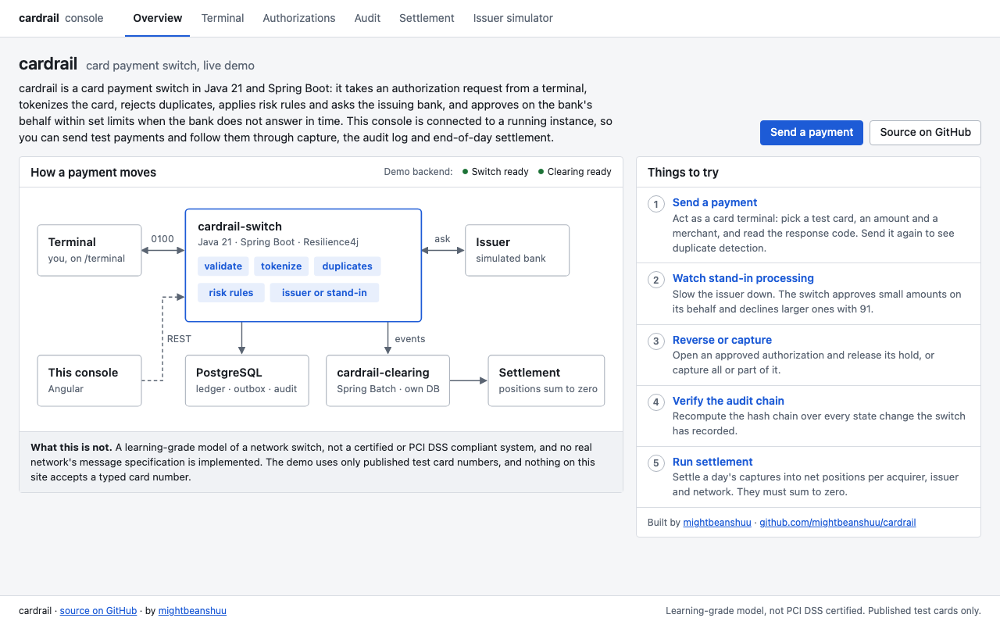
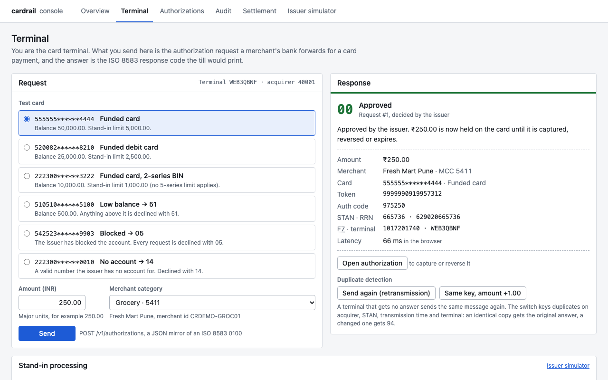
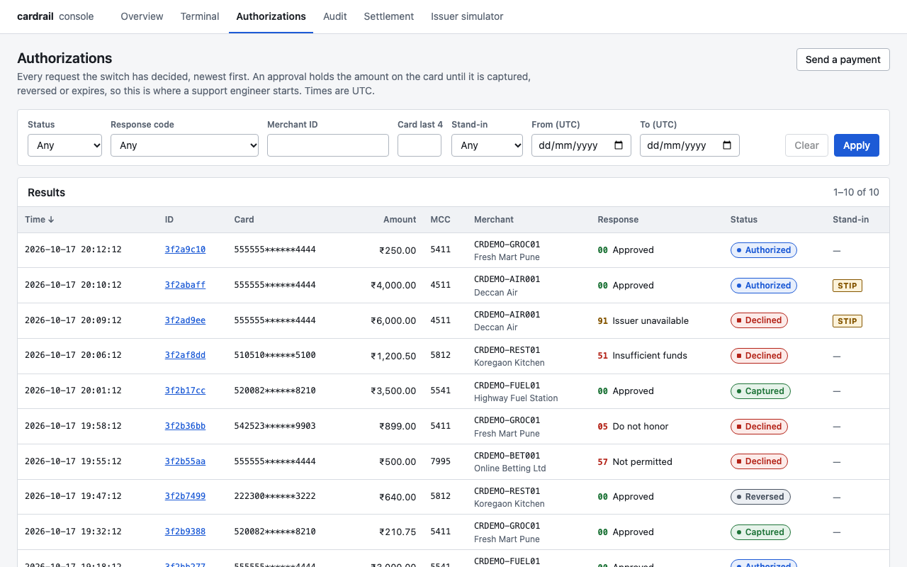

# cardrail-console

**Live demo: https://cardrail-demo.vercel.app**

The operations console for cardrail, and its public demo. A visitor acts as a card terminal, sends
test payments to a running `cardrail-switch`, and follows them through stand-in processing,
reversal and capture, the audit chain and end-of-day settlement in `cardrail-clearing`. It is UI
only and keeps no state of its own. The API contract is [`docs/CONTRACTS.md`](../docs/CONTRACTS.md),
sections 2 and 3.

Angular 22, standalone components, signals, functional interceptors, lazy routes. No UI component
library and no external fonts or CDNs.

| Overview | Terminal after a payment | Authorizations |
|---|---|---|
|  |  |  |

Also: [overview in dark mode](docs/screenshots/overview-dark.png),
[terminal at 375 px](docs/screenshots/terminal-mobile.png).

## Pages

| Route | What it does |
|---|---|
| `/` | Overview: what cardrail is, an architecture diagram (inline SVG, light and dark), five things to try, the backend's wake-up state, and what the project is not. |
| `/terminal` | Terminal simulator. Pick a test card from a fixed list, an amount and a merchant category, and send `POST /v1/authorizations`. The receipt shows the response code and why, auth code, stand-in badge, masked PAN, token, STAN/RRN and latency measured in the browser. "Send again (retransmission)" resends the identical message (the switch replays its stored answer); "Same key, amount +1.00" changes the amount under the same transmission key (94). A stand-in panel makes the simulated issuer slow or failing. Requests of this tab are listed under "This session". |
| `/authorizations` | Filter (status, response code, merchant, last 4, stand-in, UTC date range), server-side paging, newest first. Filters live in the query string, so a URL can be shared and Back works. |
| `/authorizations/:id` | All fields, a status timeline, Reverse (with confirmation) and full or partial Capture. Both are enabled only for `AUTHORIZED`. |
| `/audit` | Runs `GET /v1/audit/verify` and shows the record count or the first broken seq. |
| `/settlement` | Pick a business date, see clearing records, run settlement, see net positions per acquirer / issuer BIN / network with a per-currency reconciliation total that must be zero, download the CSV. |
| `/dev/issuer` | Reads and sets the simulated issuer's latency and failure rate (`GET`/`PUT`/`DELETE /dev/issuer/faults`). Shown when `devTools` is on, which it is in the demo build. The switch exposes the endpoint under its `dev` and `demo` profiles only. |

## How the demo works

**Test cards only.** The terminal offers a fixed list of published Mastercard test numbers from
[`src/app/demo/demo-cards.ts`](src/app/demo/demo-cards.ts), the one place to change them. There is
no input anywhere in the console that accepts a card number, so the public demo cannot receive a
real one. The full test number goes into the request body; the UI only ever renders first 6 + last 4.
A test checks that every number is Luhn-valid, in a Mastercard range and on a list of published
test numbers, and the component tests check that no full number appears in the rendered page.

| Card | Label | Expected answer | Account the switch's `demo` profile must open (INR) |
|---|---|---|---|
| `5555555555554444` | Funded card | `00`, stand-in limit 5,000.00 (BIN 555555) | 50,000.00, active |
| `5200828282828210` | Funded debit card | `00`, stand-in limit 2,500.00 | 25,000.00, active |
| `2223003122003222` | Funded card, 2-series BIN | `00`, stand-in limit 1,000.00 | 10,000.00, active |
| `5105105105105100` | Low balance → 51 | `51` above 500.00 | 500.00, active |
| `5425233430109903` | Blocked → 05 | `05` | 10,000.00, blocked |
| `2223000048410010` | No account → 14 | `14` | none (must not be seeded) |

Merchant categories: Grocery 5411, Fuel 5541, Restaurant 5812, Airline 4511, Betting 7995 (blocked
by the switch's MCC rules, so `57`).

**Request fields.** [`terminal-request.ts`](src/app/features/terminal/terminal-request.ts) builds the
switch's `AuthorizationRequestBody` the way a terminal would: one terminal id per tab (`WEB` + 5
characters, F41), a STAN that increases with every new message and wraps 999999 → 000001 (F11),
F7 as `MMDDhhmmss` in UTC, F37 as `YDDDhh` + STAN, acquirer `40001`, country `356`, POS entry
mode `051`, expiry `3012`, currency 356. A retransmission reuses the original message unchanged.
Tests run every generated request through the same format checks as the switch's `RequestValidator`.

**Cold starts.** The services run on Render's free tier, which stops an instance after 15 idle
minutes and takes roughly 30 to 90 seconds to start it again. As soon as the app loads it pings
`/actuator/health` on both services in the background (15 s per attempt, backoff 1, 2, 4, 8, then
10 s, giving up after 120 s). The overview renders immediately. If the first check is slow, a banner
says the backend is waking up and counts the seconds; API requests made meanwhile are held by an
interceptor and sent once the service answers. After 120 s the banner says so and offers a retry.

**Rate limiting.** The demo services limit requests per client address. A 429 is shown as "Too many
requests from your address. Wait a few seconds and try again." (with the server's `Retry-After`
seconds when the browser can read them), inline on the terminal and in the banner elsewhere.

**Shared issuer setting.** The simulated issuer's latency and failure rate are global to the switch
instance, so making it slow affects everyone using the demo at that moment. The UI says so next to
the controls.

## Deploying to Vercel

The console deploys as a static SPA. Create a Vercel project with **Root Directory**
`cardrail-console`; [`vercel.json`](vercel.json) sets the rest:

| Setting | Value |
|---|---|
| Install command | `npm ci` |
| Build command | `npx ng build` (production configuration) |
| Output directory | `dist/cardrail-console/browser` |
| Rewrites | every path that is not a file → `/index.html`, so deep links such as `/authorizations/<id>` load |
| Cache | `*.js` and `*.css` are content-hashed: `max-age=31536000, immutable`; `index.html` is `no-cache` |

The production build uses [`src/environments/environment.prod.ts`](src/environments/environment.prod.ts):
the switch at `https://cardrail-switch.onrender.com`, clearing at
`https://cardrail-clearing.onrender.com/v1`, and their `/actuator/health` endpoints for the
wake-up check. Both services must allow the origin `https://cardrail-demo.vercel.app` in CORS: on
`/v1/**` and `/dev/**` (`cardrail.web.allowed-origins`), on `/actuator/health`
(`management.endpoints.web.cors.allowed-origins`, method GET), and on 429 responses too, or the
browser reports them as network errors. To read `Retry-After`, expose it in CORS.

## Running against the local services

Requires Node `^22.22.3`, `^24.15.0` or `>=26` (an Angular CLI 22 requirement).

```sh
npm install
npm start            # ng serve on http://localhost:4200 with proxy.conf.json
```

`proxy.conf.json` forwards:

| Browser path | Goes to |
|---|---|
| `/v1/authorizations`, `/v1/audit`, `/dev/issuer/faults` | `http://localhost:8080` (switch) |
| `/actuator/health` | `http://localhost:8080/actuator/health` (switch wake-up check) |
| `/clearing-actuator/*` | `http://localhost:8081/actuator/*` (clearing wake-up check) |
| `/clearing/*` | `http://localhost:8081/v1/*` (clearing) |

Base URLs, the warm-up health URLs and the `devTools` flag live in `src/environments/`:
`environment.development.ts` is used by `ng serve` (proxy paths, warm-up through the proxy),
`environment.prod.ts` by `ng build` (the public demo's absolute URLs), and `environment.ts` is the
same-origin default. To call the services directly instead of through the proxy, set `switchBaseUrl` to
`http://localhost:8080` and `clearingBaseUrl` to `http://localhost:8081/v1`; both services allow
`http://localhost:4200` via CORS.

Every request carries an `X-Correlation-Id`. Failed requests are turned from RFC 7807
`application/problem+json` into a typed `ApiError` and shown in a dismissible banner with the HTTP
status and the correlation id, so the matching log lines can be found in the service.

## Tests and build

```sh
npm run test:ci      # ng test --watch=false (Vitest + jsdom, headless, no browser needed)
npm test             # watch mode
npx ng build         # production build into dist/cardrail-console/browser
```

HTTP is mocked with `HttpTestingController` throughout, so no service needs to be running.

## Money handling

Amounts are integers in minor units everywhere (paise for INR 356, cents for USD 840 and EUR 978;
JPY 392 has none). The console never converts with float arithmetic:

- Display: the minor amount is turned into a decimal string (`20010` → `"200.10"`) with integer and
  string operations, and that string is passed to `Intl.NumberFormat`, which formats it exactly.
- Input: a partial capture is typed in major units and parsed as a string. `"200.10"` → `20010`,
  `"200.1"` → `20010`; `"1.234"` (too many decimals for INR), negatives, signs, separators and
  exponents are rejected. The result must be greater than zero and at most the authorized amount.

See `src/app/shared/money.ts`.

## Card numbers

The APIs return only masked PANs (first 6 + last 4) and tokens, and the console accepts nothing
more. The terminal sends published test numbers from a fixed list and never displays them. Elsewhere: the card filter takes exactly 4 digits, a merchant id that looks like a full PAN (12 to 19
digits passing Luhn) is refused, and any unmasked number reaching the display is masked.

## Notes on the API

- Results are always newest first; the search endpoint has no sort parameter, so the table does
  not offer one.
- Date filters are UTC days. The API's `from` is inclusive and `to` exclusive, so choosing
  18 to 18 October sends `from=2026-10-18T00:00:00Z&to=2026-10-19T00:00:00Z`.
