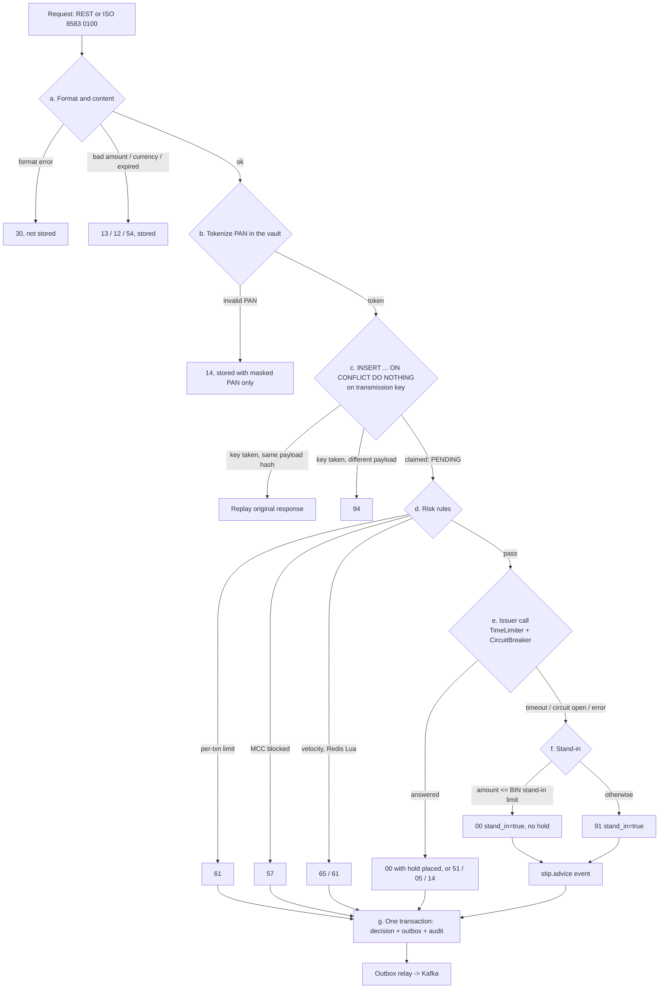

# cardrail-switch

The authorization core of cardrail: a Spring Boot 3.5 / Java 21 service that takes card
authorization requests over ISO 8583 (TCP) or REST, tokenizes the PAN into the card vault, detects
duplicate transmissions, runs risk rules, routes to the issuer (or stands in for it), and records
holds in a double-entry ledger. Every state change
writes an outbox event and an entry in a hash-chained audit log in the same transaction.

This is a learning-grade model of a network switch. It is not certified, not PCI DSS compliant, and
does not implement any real network's ISO 8583 dialect. The issuer is simulated in-process.

## Authorization pipeline



No database transaction or connection is held while waiting on the issuer. The transmission key is
claimed in one short transaction (status `PENDING`) and the decision is recorded in another. A
retransmission that arrives while the original is still `PENDING` waits briefly
(`cardrail.duplicates.in-flight-wait`) and then replays the original answer, or gets 94 if there is
still none.

## ISO 8583 over TCP

`cardrail-gateway` listens on `cardrail.iso.port` (default 8583) at `cardrail.iso.bind-address`
(default `127.0.0.1`). It starts after the rest of the application is up and, on shutdown, stops
reading, answers the requests it already has (up to `cardrail.iso.drain-timeout`), then closes.
Framing and encoding are those of `cardrail-iso8583`: a 2-byte length header, ASCII fields.

| Request | Handling |
|---|---|
| `0100` / `0101` | Fields 2, 3, 4, 7, 11, 14, 18, 19, 22, 32, 37, 41, 42, 43, 49 required (else `30`); only purchases (F3 `00xxxx`, else `12`). Same pipeline as REST; `0110` carries F38 only on approval. Fields 12/13 are echoed, not used. |
| `0400` / `0401` | Original found by F90 (original STAN, F7, acquirer) plus F41. `00` once the hold is released or there was nothing to release; repeating it is harmless. `12` if no original matches or it is already captured; `96` if it is still being decided. F4 is not read: reversals are always full. |
| `0800` F70 `301` | Echo, answered `0810` / `00` by the gateway itself. |
| anything else | `12` |

The space padding of F41, F42 and F43 is removed before storing. F90 carries the acquirer ID
zero-padded to 11 digits; it is matched against the 0400's own F32 to recover the original spelling.

Drive it with `cardrail-loadgen`, using the demo cards from the dev profile:

```sh
mvn -q -pl cardrail-loadgen -am package -DskipTests
printf '5555555555554444,3012\n5105105105105100,3012\n' > /tmp/demo-cards.txt
java -jar cardrail-loadgen/target/cardrail-loadgen-0.1.0-SNAPSHOT.jar \
    --port 8583 --rate 2 --duration 10s --warmup 1s --pans /tmp/demo-cards.txt
```

Gateway metrics: `cardrail.iso.connections` (gauge), `cardrail.iso.connections.closed` (by reason),
`cardrail.iso.connections.rejected`, and `cardrail.iso.requests`, a timer by `mti` and
`response_code` from frame read to response written.

### Benchmark harness

`scripts/bench.sh` builds the switch and the load generator, starts the switch (dev profile, log
outbox), opens a funded account for each card of `CardPool.generated(cards, seed, ...)` through the
dev-only `POST /dev/accounts`, runs the load generator with the same `--cards` and `--seed` (so
every request hits a funded account), and prints the generator's report and the host it ran on.

```sh
cardrail-switch/scripts/bench.sh --rate 500 --connections 4 --duration 20s --warmup 5s
```

It uses the dev database and ports 28080/28583 (`BENCH_HTTP_PORT`, `BENCH_ISO_PORT`). Numbers from
it describe that run on that machine, with the switch, PostgreSQL, Redis and the generator sharing
the CPU.

## Card vault and keys

PANs are tokenized by `cardrail-vault` ([ADR 0007](docs/adr/0007-vault-backed-tokenization.md)):
each PAN is AES-256-GCM encrypted under its own data key, the data key is wrapped by a versioned
KEK, and an HMAC blind index finds the record again, so the same PAN always gets the same 16-digit
token (BIN `999999`). Records are in `vault_record`; nothing in the database holds a PAN.

```yaml
cardrail:
  vault:
    token-bin: "999999"
    keks:                      # exactly one ACTIVE; older ones DECRYPT_ONLY until rewrapped
      - id: kek-2026-10
        key: <base64 of 32 random bytes>
        status: ACTIVE
    blind-index-key: <base64, at least 32 bytes>   # never rotated with the KEKs
```

From the environment: `CARDRAIL_VAULT_KEKS_0_ID`, `CARDRAIL_VAULT_KEKS_0_KEY`,
`CARDRAIL_VAULT_KEKS_0_STATUS`, `CARDRAIL_VAULT_BLIND_INDEX_KEY`. Generate a key with
`openssl rand -base64 32`. The `dev` and `test` profiles ship fixed development keys that are
published in `application.yml` and are not secret; without a profile there are no keys and the
switch does not start, and in any other profile it refuses to start if it finds a development key
(matched by fingerprint, not by name). `cardrail.tokenizer=dev` switches back to the keyless dev
tokenizer, whose tokens are different and cannot be detokenized.

Every detokenize call, granted or not, is written to the audit log (`PAN_DETOKENIZE`, with reason,
outcome and KEK id, never the PAN) before the PAN is released. Nothing in the switch detokenizes
today; the vault is ready for clearing and disputes to do so.

## Why declines are HTTP 200

A switch always answers an authorization request with a response message; "insufficient funds" is a
normal answer, carried in field 39, not a failure of the exchange. The REST API keeps that: whenever
the switch reached a decision the status is 200 and the body carries `responseCode` (`00`, `51`,
`91`, ...). HTTP errors are reserved for requests the switch could not process at all, and are RFC
7807 problem details:

| Status | When |
|---|---|
| 400 | the JSON is missing fields or has the wrong types |
| 404 | unknown authorization id |
| 409 | reversal of a captured authorization, capture of a reversed one, and so on |
| 422 | capture amount outside 1..authorized amount |
| 500 | unexpected failure; retrying with the same transmission key is safe |

Field formats (STAN, F7, MCC, expiry...) are checked by the switch itself and answered with `30`,
exactly as the ISO 8583 entry point would, rather than by Bean Validation.

## Running locally

Requires Java 21, PostgreSQL 17 on `localhost:5432` (user `mac`, database `cardrail`) and Redis on
`localhost:6379`. Kafka is optional: by default the outbox relay "publishes" by logging
(`cardrail.outbox.publisher=log`); set it to `kafka` and `spring.kafka.bootstrap-servers` to use a
broker. The switch listens on HTTP 8080 and on ISO 8583 TCP 8583 (loopback only by default).

```sh
export JAVA_HOME=/opt/homebrew/opt/openjdk@21/libexec/openjdk.jdk/Contents/Home
cd /Users/mac/cardrail
mvn -q -pl cardrail-switch -DskipTests package
java -jar cardrail-switch/target/cardrail-switch-0.1.0-SNAPSHOT.jar --spring.profiles.active=dev
```

The `dev` profile opens three demo accounts (INR): `5555555555554444` with 50,000.00,
`5105105105105100` with 500.00, and `2223003122003222` (blocked). It also enables the fault
injection endpoint for the simulated issuer and `POST /dev/accounts` (below), and supplies the
development vault keys. Add the `json` profile for ECS JSON logs.

Swagger UI: http://localhost:8080/swagger-ui.html. Metrics: http://localhost:8080/actuator/prometheus.

### API examples

Authorize INR 200.00 at a grocery store:

```sh
curl -s -X POST localhost:8080/v1/authorizations -H 'Content-Type: application/json' -d '{
  "pan": "5555555555554444", "expiry": "3012", "amountMinor": 20000, "currency": 356,
  "mcc": "5411", "merchantId": "MERCHANT0000001", "merchantName": "Fresh Mart Pune",
  "merchantCountry": "356", "terminalId": "TERM0001", "acquirerId": "40001",
  "stan": "000001", "rrn": "000000000001", "transmissionDateTime": "1017103000",
  "posEntryMode": "051"}'
```

```json
{"id":"64146a04-...","approved":true,"responseCode":"00","responseCodeName":"APPROVED",
 "authCode":"975250","standIn":false,"maskedPan":"555555******4444","token":"9999990919957312"}
```

Sending the identical request again returns the identical response (same id and auth code) and does
not place a second hold. Changing the amount but keeping STAN, F7, terminal and acquirer returns 94.

```sh
ID=64146a04-...                                   # from the response above
curl -s localhost:8080/v1/authorizations/$ID      # full stored view
curl -s -X POST localhost:8080/v1/authorizations/$ID/capture \
     -H 'Content-Type: application/json' -d '{"amountMinor": 15000}'   # partial; omit body for full
curl -s -X POST localhost:8080/v1/authorizations/$ID/reversal           # idempotent; 409 once captured
curl -s localhost:8080/v1/audit/verify            # {"intact":true,"recordsVerified":3}
```

Search, newest first. All filters are optional and combine with AND: `status`, `responseCode`,
`merchantId`, `last4`, `standIn`, `from` (inclusive) and `to` (exclusive) as ISO-8601 instants,
`page` (0-based) and `size` (default 20, at most 100). Out-of-range values are a 400 problem.

```sh
curl -s 'localhost:8080/v1/authorizations?status=DECLINED&last4=5100&size=10'
# {"items":[{"id":"...","status":"DECLINED","responseCode":"51",...}],"page":0,"size":10,"total":1}
```

`total` counts every match, and is read in the same snapshot as the page. Paging is by offset, so a
deep page costs a scan of the rows before it; V8 adds the indexes for the newest-first order, with
separate ones for `merchantId` and `last4`.

CORS allows the origins in `cardrail.web.allowed-origins` (default `http://localhost:4200`, the
console's dev server) on `/v1/**` and `/dev/**`, without credentials.

Make the issuer slower than the 1.5 s time limiter and watch stand-in take over:

```sh
curl -s -X PUT localhost:8080/dev/issuer/faults -H 'Content-Type: application/json' \
     -d '{"latencyMs": 3000, "failureRate": 0}'
# authorize again with a new stan/rrn: "standIn": true, and a stip.advice event in the outbox
curl -s -X DELETE localhost:8080/dev/issuer/faults   # back to configured settings
```

## Tests

```sh
export JAVA_HOME=/opt/homebrew/opt/openjdk@21/libexec/openjdk.jdk/Contents/Home
cd /Users/mac/cardrail
mvn -q -B -o -pl cardrail-switch verify                       # everything
mvn -B -o -pl cardrail-switch test -Dtest=ConcurrencyIntegrationTest
mvn -B -o -pl cardrail-switch test -Dtest=CucumberSuiteTest   # BDD only; report in target/cucumber-report.html
```

Integration tests run against real PostgreSQL (`cardrail_test`, cleaned and migrated at context
start) and real Redis (database 15), with Kafka from `@EmbeddedKafka` and the ISO 8583 gateway on
an ephemeral port. All of them share one Spring context. There is no Docker and no Testcontainers.

| Area | Where |
|---|---|
| Domain rules (Luhn, masking, expiry, duplicates, velocity, stand-in policy, journal, hash chain) | `src/test/java/.../domain` |
| Collaborators in isolation (validator, risk rules, Redis-down fallback, duplicate resolver, issuer resilience, outbox relay) | `src/test/java/.../application` |
| Ledger: unbalanced journal rejected at commit, append-only entries, late-hold void | `LedgerIntegrationTest` |
| 200 concurrent INR 1.00 authorizations on a 100.00 balance: exactly 100 approved, 100 x 51, no overdraft, ledger reconciles | `ConcurrencyIntegrationTest` |
| Stand-in on timeout, 91 above limit, circuit opens and stops calling the issuer | `StandInIntegrationTest` |
| Audit: UPDATE/DELETE rejected, tampered row found at its exact seq, 100 concurrent writers keep one chain | `AuditLogIntegrationTest` |
| Exactly one Kafka record per approval, keyed by token | `OutboxKafkaIntegrationTest` |
| Over real TCP with the load generator's acquirer: approvals, 51, a retransmission replayed, a 0400 releasing the hold, echo, unknown MTI | `IsoTcpEndToEndTest` |
| 0100/0400 field mapping, missing fields, F90 acquirer padding, reversal response codes | `SwitchIsoHandlerTest` |
| Vault: 16-digit tokens, same PAN same token (also after a restart), 32 concurrent first sightings agree, both insert conflicts, rewrap compare-and-set, KEK rotation, detokenize audited | `VaultTokenizationIntegrationTest` |
| Key configuration errors; development keys refused outside dev/test | `ConfiguredKeyProviderTest` |
| Search filters, half-open time range, paging and totals, 400s, index use, CORS | `AuthorizationSearchIntegrationTest` |
| No PAN in console or JSON logs; tokens stay readable | `PanMaskingLoggingTest`, `LogRedactionTest` |
| Business-language scenarios | `src/test/resources/features/*.feature` |
| Layering (domain is plain Java, adapters independent, no `System.out`) | `ArchitectureTest` |

## Design notes

- **Explicit SQL** through `JdbcClient`, no JPA ([ADR 0001](docs/adr/0001-explicit-sql-over-jpa.md)).
- **Double entry enforced by PostgreSQL**: a deferred constraint trigger rejects any journal whose
  entries do not sum to zero at commit; journals are append-only ([ADR 0002](docs/adr/0002-db-enforced-double-entry.md)).
- **Duplicates by unique key**, never check-then-insert ([ADR 0003](docs/adr/0003-duplicate-detection-via-unique-key.md)).
- **Stand-in** approves only up to a per-BIN limit and never holds funds ([ADR 0004](docs/adr/0004-stip-policy.md)).
- **Redis down** means stricter limits from the database, not fail-open ([ADR 0005](docs/adr/0005-redis-down-degradation.md)).
- **Transactional outbox** with `FOR UPDATE SKIP LOCKED` ([ADR 0006](docs/adr/0006-transactional-outbox.md)).
- **No leaked holds on timeout.** When the switch stops waiting for the issuer, `voidHold` inserts a
  tombstone keyed by the authorization id. If the issuer's transaction is still running, the insert
  waits for it; a hold it committed is released, and a hold it had not yet placed is refused.
- **Lock order** is authorization row, then hold row, then account row, and the audit chain lock is
  always taken last. The hold-expiry sweeper locks a batch of accounts and takes them in token order.
- **Abandoned requests.** A request that dies between claiming its key and recording its decision
  leaves a `PENDING` row; after `cardrail.holds.abandoned-after` it is declined 96 and any hold
  released, so retransmissions get a definite answer.
- **Logs never print a full PAN.** `%m`, `%msg`, `%message` and `%wEx` are replaced in
  `logback-spring.xml` by converters that run the vault's `PanRedactor`: every Luhn-valid 13 to 19
  digit run, also when grouped by spaces or dashes, is masked to first 6 + last 4; the JSON log
  profile applies the same to every string value. Vault tokens are exempt so log lines stay
  correlatable; the dev tokenizer's 19-digit tokens are not in the vault's format and are masked.
  The gateway logs through `System.Logger`, which Spring Boot routes into the same Logback setup.
- **Metrics**: `cardrail.iso.*` (above), `cardrail.authorization.latency` (tags `response_code`, `stand_in`),
  `cardrail.stip.decisions`, `cardrail.authorization.duplicates`, `cardrail.risk.declines`,
  `cardrail.risk.velocity.degraded`, `cardrail.issuer.late_holds_released`, `cardrail.outbox.publish`,
  plus Resilience4j's circuit breaker metrics.

## Limitations

- The issuer is simulated in the same database. Account currency must match the transaction
  currency (no conversion); otherwise the issuer answers 12.
- Stand-in approvals hold no funds and cannot be captured here: in a real network the issuer posts
  them when it processes the stand-in advice, which is not modelled.
- Velocity is counted per card and currency, on attempts that pass the cheaper rules.
- Delivery from the outbox is at least once; consumers should deduplicate on the
  `cardrail-event-id` header. A message that exhausts `max-attempts` stays in the table for an operator.
- A reversal whose original is unknown is answered `12` and not stored, so an original that arrives
  after its own reversal is not caught; its hold is released only by expiry. Partial reversals are
  not supported.
- Vault keys are held in the JVM heap (no HSM/KMS integration), KEK rewrap after rotation is not
  scheduled, and the blind index key cannot be rotated.
- Search uses offset paging and an exact `count(*)`, both of which get slower as the table grows.
